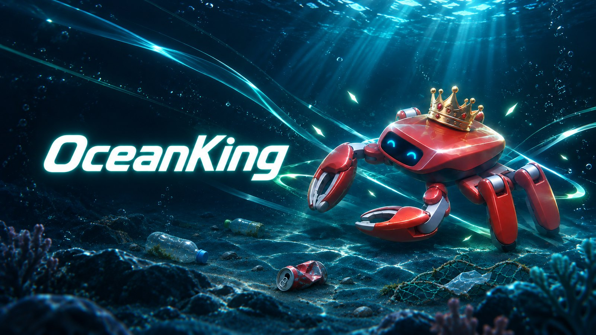
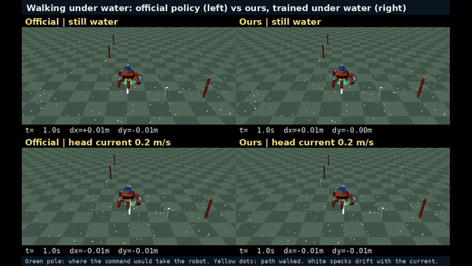
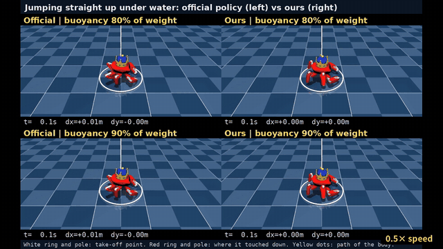
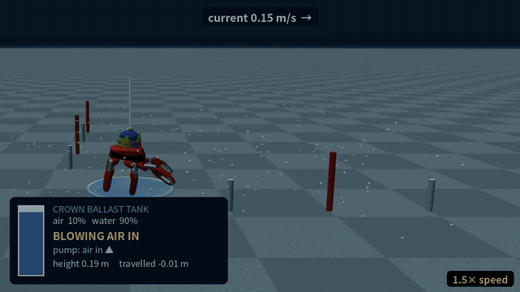
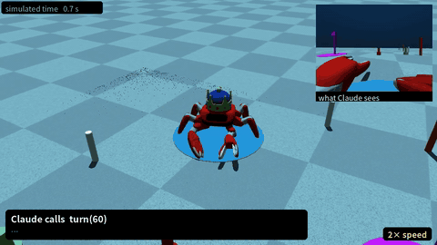

# OceanKing: A Crab, a Crown, and Claude

[](https://www.youtube.com/watch?v=d0wBdI-428E)

**A land robot, sunk to the seabed.** [Jumper](https://github.com/KingKongRobotics/jumper) is an
open-source 22-DoF crab robot built for walking on land. OceanKing puts it under water in
[MuJoCo](https://mujoco.org): buoyancy on every part, drag calibrated part by part, added mass and
currents. It teaches the robot, by reinforcement learning, to walk against the current and to jump
in water; gives it a crown that is really a ballast tank; and hands the controls to
[Claude](https://www.anthropic.com/claude), which looks through the robot's own camera and
collects trash from the seabed.

Everything here is simulation. **[Watch the video (2 min) on YouTube](https://www.youtube.com/watch?v=d0wBdI-428E)** (also in
[`assets/video/`](assets/video/oceanking.mp4)).

| | |
|---|---|
| **Walking against the current.** Left: the official land policy. Right: ours, fine-tuned under water. In a 0.2 m/s head current (bottom row) the official walk is pushed back; ours walks on. White specks drift with the water; the green pole is where the command would take the robot. |  |
| **Jumping, and landing where it took off.** Under water a jump is a slow float, and the official jump drifts 7-12 cm while it floats. Ours lands within 2 cm of its take-off point. (0.5x speed) |  |
| **The crown is a ballast tank.** Jump, blow air into the crown to hover 0.3 m above the seabed, ride a 0.15 m/s current, flood the tank to land: 1.8 m in one hop. (1.5x speed) |  |
| **Claude takes the controls.** Claude sees only the onboard camera and a colour detector, and calls skills: look, approach, grasp, go_to, release. A missed grasp is reported back; it backs off and tries again. With a bottle in the claw the robot walks sideways, like a crab. (2x speed) |  |

## What is in it

### Underwater physics ([`docs/PHYSICS.md`](docs/PHYSICS.md))

MuJoCo has fluid drag but no buoyancy, so OceanKing adds it:

- **Buoyancy** at each of the 41 links' own centre of buoyancy, from the convex hull of its collision
  mesh, so a tilted robot feels the righting and capsizing moments a real hull does. Sealed, Jumper
  floats (buoyancy / weight `beta = 1.35`).
- **A ballast kit**: a lead keel inside the torso, sized and placed to trim the robot to the
  requested `beta`, and a **crown** on its roof whose band and dome are one buoyant tank. Default
  `beta = 0.8`: under water the robot weighs a fifth of its weight on land.
- **Drag** from MuJoCo's ellipsoid fluid model, calibrated group by group (torso, crown, legs, arms)
  to realistic drag coefficients; **added mass**; a uniform **current**.
- **A MuJoCo Warp fix**: Warp's fluid torque missed each geom's lever arm about the body's centre of
  mass ([`oceanking/warp_patch.py`](oceanking/warp_patch.py); material for an upstream report in
  [`upstream/`](upstream)). Training runs on Warp (GPU) and replays on native MuJoCo (CPU), so the
  two have to agree.

### Policies, fine-tuned under water ([`docs/TRAINING.md`](docs/TRAINING.md), [`docs/JUMP.md`](docs/JUMP.md))

PPO from the official checkpoints, 4096 environments, with buoyancy, current and ground friction
randomised per environment. Commands are tracked only as far as the physics allows (traction against
drag sets a speed limit per current and `beta`), and each policy was judged by criteria fixed before
training, against the official one.

| Task | Policy | Result |
|---|---|---|
| `ocean.walk` | [`out/run4`](oceanking/tasks/ocean/walk/out/run4) | Passes all five criteria: 1.18x the official speed on small commands, **1.53x into a head current**, no extra drift when told to stand |
| `ocean.jump` | [`out/run5`](oceanking/tasks/ocean/jump/out/run5) | As high as the official jump; **lands 0.0-0.02 m from its take-off point** (official: 0.05-0.12 m) |
| `ocean.five_foot` | [`out/reach`](oceanking/tasks/ocean/five_foot/out/reach) | Walks with the claw held out, and with a load lifted ~3 cm (the official five-foot policy does not move with its arm out) |

The long jump is not learnt: the jump policy takes off, and
[`tank_hover.py`](oceanking/tasks/ocean/jump/tank_hover.py) runs the crown's pump (PI control on
height) while the current carries the robot ([`oceanking/tank.py`](oceanking/tank.py) changes the
crown's mass, centre of mass and inertia as it fills).

### Claude on the seabed ([`docs/DEMO.md`](docs/DEMO.md))

A manual tool-use loop ([`oceanking/demo/agent.py`](oceanking/demo/agent.py)) with
`claude-opus-5-5`. Claude gets nothing the robot would not have: the onboard camera image, a colour
detector's list (label, distance, bearing), odometry and the claw's encoder. The skills
([`oceanking/demo/skills.py`](oceanking/demo/skills.py)) close the loop on those: approach with the
camera tracking the target, grasp judged from how far the finger closed, carry sideways without
turning, a release spot of its own for each piece. The trash's true positions are read only by the
scorer.

It is not reliable yet: about half of the grasps miss, and in the final configuration 2 of 8 runs
delivered both bottles. Every failure is reported to Claude, which decides how to retry.

## Quick start

Tested on Linux, Python 3.12, an RTX PRO 6000 Blackwell (training only; replays and the demo run on
the CPU).

```bash
uv venv --python 3.12 .venv
VIRTUAL_ENV=.venv uv pip install torch torchvision --index-url https://download.pytorch.org/whl/cu130
VIRTUAL_ENV=.venv uv pip install -e "./jumper[dev]" -e ".[dev,demo]"
```

Claude collects the trash (needs an API key: `cp .env.sample .env` and fill in `CLAUDE_API_KEY`, or
export `ANTHROPIC_API_KEY`):

```bash
MUJOCO_GL=egl .venv/bin/python -m oceanking.demo.agent --video run.mp4 --transcript run.json
MUJOCO_GL=egl .venv/bin/python -m oceanking.demo.agent --dry-run --video dry.mp4   # no API: a script
```

The trained policies, in the live viewer:

```bash
cd jumper
../.venv/bin/python scripts/play.py --task ocean.walk --scene seabed_rock \
    --checkpoint ../oceanking/tasks/ocean/walk/out/run4/model_75600.pt --current -0.2 0
../.venv/bin/python scripts/play.py --task ocean.jump --buoyancy 0.9 --jump 0 0 \
    --checkpoint ../oceanking/tasks/ocean/jump/out/run5/model_11000.pt
../.venv/bin/python scripts/play.py --task ocean.jump --scene seabed --jump 0 0 --nominal \
    --current 0.15 0 --episode-s 16 --tank-script ../oceanking/tasks/ocean/jump/tank_hover.py \
    --checkpoint ../oceanking/tasks/ocean/jump/out/run5/model_11000.pt          # the long jump
```

The official land policy runs in the same water unchanged (`ocean.posture`), for comparison:

```bash
../.venv/bin/python scripts/play.py --task ocean.posture --scene seabed \
    --checkpoint tasks/jumper/posture/out/example/model_74800.pt --buoyancy 0.8 --current -0.3 0
```

Videos like the ones above, with the current, the commanded position or the take-off and landing
drawn in: [`oceanking/tools/showcase_video.py`](oceanking/tools/showcase_video.py) and
[`compare_video.py`](oceanking/tools/compare_video.py). Scenes (`--scene`): `seabed` (flat),
`seabed_rock` (wet rock, friction 0.5), `seabed_sand` (friction 0.6). Training:
`scripts/train.py --task ocean.walk` (see [`docs/TRAINING.md`](docs/TRAINING.md)).

Tests:

```bash
.venv/bin/python -m pytest tests/ -q                       # OceanKing
cd jumper && ../.venv/bin/python -m pytest tests/ -q       # upstream, including OceanKing's tasks
```

## Repository layout

| Path | Contents |
|---|---|
| `oceanking/` | OceanKing: underwater physics (`hydro.py`, `buoyancy.py`, `drag.py`, `water.py`, `tank.py`, `crown.py`), tasks (`tasks/ocean/`), scenes, the Claude demo (`demo/`), tools |
| `jumper/` | The upstream [Jumper](https://github.com/KingKongRobotics/jumper) repository (Apache-2.0), merged with its history: training, replay, the robot model |
| `docs/` | Specifications and results: physics, training, jump, grasp, demo |
| `tests/` | OceanKing's tests |
| `upstream/` | A bug found upstream (MuJoCo Warp's fluid torque) and the material to report it |
| `assets/` | Images and videos for this page |

Upstream's `scripts/train.py`, `play.py` and `export.py` are used unchanged. A task id is a module
under `jumper/tasks/` and a scene id a module under `jumper/scenes/`, so OceanKing's sources live in
`oceanking/` and `jumper/` holds symlinks to them plus one line marked `[oceanking]` in each
package's `__init__.py`:

```
jumper/tasks/ocean        -> oceanking/tasks/ocean        (task ids ocean.*)
jumper/scenes/seabed*.py  -> oceanking/scenes/seabed*.py  (scene ids seabed, seabed_rock, seabed_sand)
```

Physics that defines the experiment (the water) belongs to a task; what the world looks like and what
the ground is belongs to a scene. [`oceanking/plugin.py`](oceanking/plugin.py) explains how to add
either. Upstream changes are merged with `git fetch upstream && git merge -X subtree=jumper
upstream/main`.

## Credits

- [Jumper](https://github.com/KingKongRobotics/jumper) by KingKong Robotics (Apache-2.0): the robot,
  its model, the official policies and the training stack (with vendored
  [mjlab](https://github.com/mujocolab/mjlab) and [rsl_rl](https://github.com/leggedrobotics/rsl_rl)).
- [MuJoCo](https://github.com/google-deepmind/mujoco) and
  [MuJoCo Warp](https://github.com/google-deepmind/mujoco_warp).
- [Claude](https://www.anthropic.com/claude) drives the demo; OceanKing was developed with
  [Claude Code](https://claude.com/claude-code).

## License

[Apache License 2.0](LICENSE), as upstream Jumper. `jumper/` keeps its own [LICENSE](jumper/LICENSE)
and notices.
